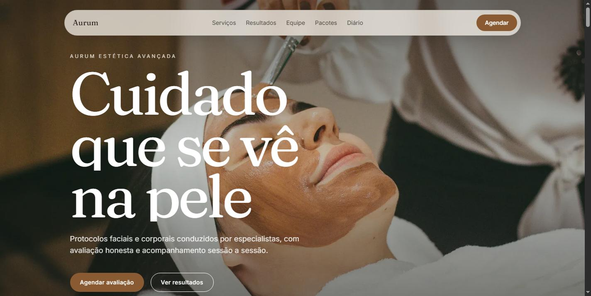

# Aurum — Aesthetic Clinic Website with Booking (Demo)

A website and appointment system for a fictional premium aesthetic clinic: public pages, real bookings saved to a database, availability calculated from each professional's schedule, and an authenticated admin panel.

**Live demo:** https://beauty.zevro.app



> **Demo project.** The clinic, team, treatments and contact details are fictional. This is my own portfolio piece, not client work. The site content is in Brazilian Portuguese.

## What it includes

- Public site: home, services catalogue, service pages, about and contact
- Booking flow that saves appointments to PostgreSQL and computes free time slots from each professional's working hours
- Floating WhatsApp button (`wa.me` deep link)
- Admin panel (credentials login) to manage services, professionals and their hours, and appointments
- Automated tests (Vitest and Testing Library): type check, unit and component tests

## Stack

- Next.js 16 (App Router), React, TypeScript
- Prisma 5 and PostgreSQL
- NextAuth (credentials provider)
- Tailwind CSS 3
- Vitest and Testing Library

## Run locally

Requirements: Node.js 20+ and a PostgreSQL database (developed against Neon).

```bash
npm install
cp .env.example .env     # fill in DATABASE_URL, NEXTAUTH_SECRET and SEED_ADMIN_PASSWORD
npx prisma migrate deploy
npx prisma db seed       # creates demo services, a professional and the admin user
npm run dev              # http://localhost:3000, admin at /admin/login
```

The admin password is read from `SEED_ADMIN_PASSWORD`; it is never stored in the code.

## Scripts

| Command | What it does |
|---|---|
| `npm run dev` | Development server |
| `npm run build` | Production build |
| `npm test` | Test suite (Vitest) |
| `npm run lint` | ESLint |

## Notes

- Photos are from Unsplash (free license); see `docs/IMAGENS.md`.
- Source is public for review. All rights reserved; contact me before reusing it in another project.
